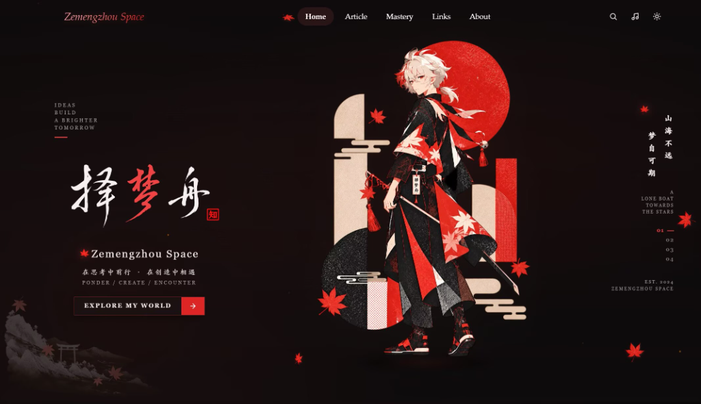

  AGENT TOOLING &nbsp; / &nbsp; ENGINEERING &nbsp; / &nbsp; TECHNICAL WRITING

  <a href="https://zemengzhou.com/"><b>Blog</b></a>
  &nbsp; · &nbsp;
  <a href="https://www.zhihu.com/people/ze-meng-zhou-29"><b>Zhihu</b></a>
  &nbsp; · &nbsp;
  <a href="https://github.com/dreamfarer-space?tab=repositories"><b>Repositories</b></a>

 

### 01 &nbsp; Selected projects

<table width="100%">
  <tr>
    <td width="50%" valign="top">
      
BUILD / INTERACTIVE AI

      <h3><a href="https://github.com/dreamfarer-space/deepseek-harness-intelligent-ui">Intelligent UI</a></h3>
      
Streaming components, charts, and live widgets for DeepSeek Harness.

      
<a href="https://github.com/dreamfarer-space/deepseek-harness-intelligent-ui">Explore project ↗</a>

    </td>
    <td width="50%" valign="top">
      
WRITE / ENGINEERING NOTES

      <h3><a href="https://zemengzhou.com/">Zemengzhou Space</a></h3>
      
Notes on engineering, mathematics, and building software.

      
<a href="https://zemengzhou.com/">Read the journal ↗</a>

    </td>
  </tr>
</table>

 

### 02 &nbsp; Open source

<table width="100%">
  <tr>
    <td width="50%" valign="top">
      
CHAT / LOCALIZATION

      <h3><a href="https://github.com/milind-soni/OpenMausBot">OpenMausBot</a></h3>
      
Chinese localization, LaTeX rendering, and chat improvements.

      
<a href="https://github.com/milind-soni/OpenMausBot/pull/1719">Localization ↗</a> &nbsp; · &nbsp; <a href="https://github.com/milind-soni/OpenMausBot/pull/1608">Math rendering ↗</a>

    </td>
    <td width="50%" valign="top">
      
MOBILE / REMOTE ACCESS

      <h3><a href="https://github.com/liguobao/ds-harness-remote">ds-harness-remote</a></h3>
      
Android chat interactions and reliable remote previews.

      
<a href="https://github.com/liguobao/ds-harness-remote/pull/112">Android UX ↗</a> &nbsp; · &nbsp; <a href="https://github.com/liguobao/ds-harness-remote/pull/86">Preview isolation ↗</a>

    </td>
  </tr>
  <tr>
    <td width="50%" valign="top">
      
RUNTIME / RELIABILITY

      <h3><a href="https://github.com/fish2lab/DSCodex">DSCodex</a></h3>
      
Windows compatibility, router recovery, and credential protection.

      
<a href="https://github.com/fish2lab/DSCodex/pull/19">Recovery ↗</a> &nbsp; · &nbsp; <a href="https://github.com/fish2lab/DSCodex/pull/5">Security ↗</a>

    </td>
    <td width="50%" valign="top">
      
DESKTOP / UPSTREAM ADOPTION

      <h3><a href="https://github.com/NousResearch/hermes-agent">hermes-agent</a></h3>
      
Process-check optimization incorporated upstream with authorship credit.

      
<a href="https://github.com/NousResearch/hermes-agent/pull/127983">Credited adoption ↗</a> &nbsp; · &nbsp; <a href="CONTRIBUTIONS.md#additional-upstream-contributions">Attribution ↗</a>

    </td>
  </tr>
</table>

 

  <a href="CONTRIBUTIONS.md"><b>Contribution archive &amp; attribution →</b></a>

  <a href="https://github.com/search?q=author%3Adreamfarer-space+is%3Apr+is%3Amerged+-user%3Adreamfarer-space&amp;type=pullrequests">Browse all merged PRs</a>

<!-- Keep this page selective. Add new PRs to CONTRIBUTIONS.md rather than extending these cards. -->
